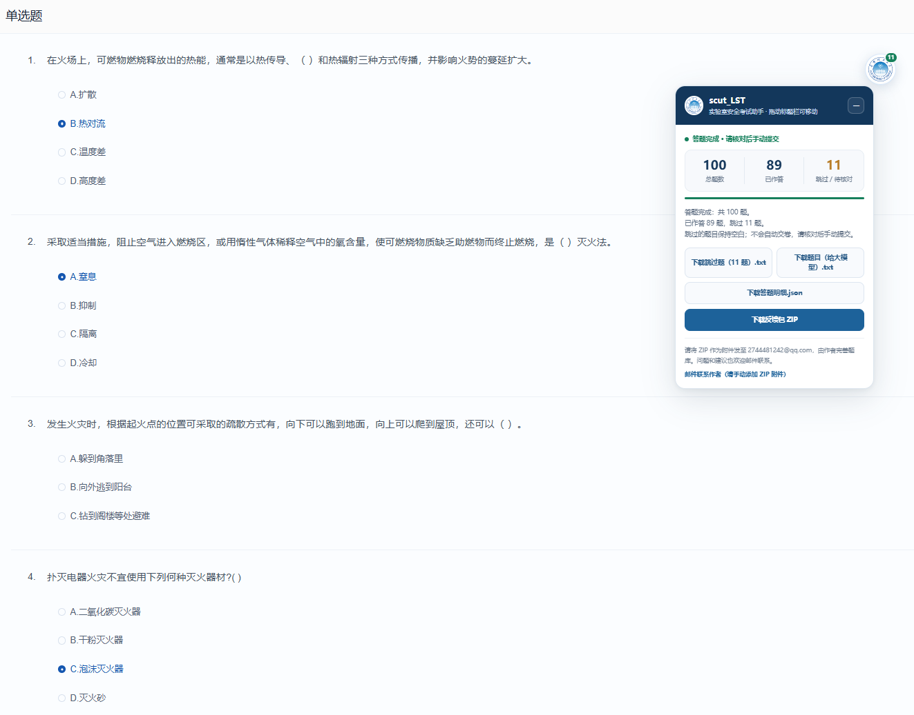

# scut_LST

**华南理工大学实验室安全考试辅助 Chrome 扩展。**

`scut_LST` 面向华工实验室安全综合管理系统。打开试卷后，扩展根据本地题库匹配题目并勾选答案，显示作答进度和跳过情况。答题完成后，由你核对答案、补答未匹配的题目，并手动提交试卷。

遇到题库缺漏或答案问题时，可以下载本轮答题的反馈 ZIP，发送给作者补充和完善。

- **适用平台**：[华工实验室安全综合管理系统](https://zhsys.sb.scut.edu.cn/)
- **扩展名称**：scut_LST
- **当前版本**：1.0.0
- **反馈邮箱**：[2744481242@qq.com](mailto:2744481242@qq.com)

> 扩展不会自动交卷。匹配结果仅供辅助使用，请核对答案，并留意平台自身的考试倒计时。

## 功能介绍

| 功能 | 说明 |
| --- | --- |
| 自动匹配答案 | 按本地题库匹配试卷中的单选、多选和判断题，并勾选对应选项 |
| 适应选项顺序变化 | 按选项文本匹配，不直接照搬题库里的选项字母 |
| 显示作答进度 | 在可拖拽的悬浮面板中显示进度、已作答数量和跳过数量 |
| 跳过不确定的题目 | 没有找到题目、存在难以区分的相近题，或选项无法可靠匹配时，跳过并提示原因 |
| 等待试卷加载 | 可以先启动扩展，再在 10 分钟内打开试卷 |
| 下载反馈 ZIP | 将本轮题目、答题明细和跳过题打包，方便发给作者完善 |

安装和使用扩展无需安装 Python，也无需在电脑上运行额外脚本。题库维护、问题排查和修复由作者处理。

## 使用效果

下面是实际试卷页面中的使用截图：扩展勾选匹配到的答案，悬浮面板显示本轮作答统计，并提供题目、答题明细和反馈 ZIP 的下载入口。



图中这轮试卷共 100 题，已作答 89 题，跳过 11 题。使用时可以按下面的流程操作：

1. **打开试卷并启动扩展**：点击 **开始自动答题**，等待面板显示作答进度。
2. **移动或收起面板**：拖动深蓝色标题栏调整位置；点击右上角的 **−** 收起为校徽悬浮球，点击校徽重新展开。
3. **核对答案并反馈**：检查已勾选的答案，自行补答跳过题；需要反馈时下载 ZIP，作为邮件附件发送给作者，最后由你手动提交试卷。

## 下载与安装

### 1. 下载项目

打开 [scut_LST 仓库](https://github.com/yogurt-lover66/scut_LST)，点击绿色的 **Code** 按钮，再点击 **Download ZIP**。

下载后，将 ZIP 解压到一个固定文件夹。后续使用扩展时需要保留这个文件夹，不要安装后将它删除或随意移动。

### 2. 加载 Chrome 扩展

1. 打开 Chrome，在地址栏输入 `chrome://extensions/` 并回车。
2. 开启页面右上角的 **开发者模式**。
3. 点击 **加载未打包的扩展程序**。
4. 选择解压后的项目文件夹。
5. 确认扩展列表中出现 **scut_LST**，并且处于启用状态。

选择的文件夹应该直接包含 `manifest.json`，例如：

```text
scut_LST-main/
├── manifest.json
├── README.md
├── extension/
│   ├── content.js
│   ├── popup.html
│   └── popup.js
└── asset/
    ├── questions.json
    ├── extra.json
    └── scut-emblem.svg
```

不要选择 ZIP 文件本身，也不要只选择 `extension` 或 `asset` 子文件夹。

### 3. 固定到工具栏

点击 Chrome 工具栏中的扩展程序图标，找到 **scut_LST**，点击旁边的固定图标。之后就可以从工具栏直接打开扩展。

## 使用步骤

### 1. 登录并打开试卷

自行登录 [实验室安全综合管理系统](https://zhsys.sb.scut.edu.cn/)，进入考试列表并打开需要作答的试卷。

登录过程由学校平台处理，扩展不会替你输入账号或密码。

### 2. 启动自动答题

保持试卷页面为当前标签页，点击工具栏中的扩展图标，然后点击 **开始自动答题**。

启动后，请查看网页上的悬浮面板。面板会显示题库加载、等待试卷或正在答题等状态，作答过程中会更新进度。

面板采用白色卡片和深蓝标题栏，顶部显示总题数、已作答数和跳过数。你可以拖动标题栏调整位置；点击标题栏右侧的 **收起按钮（−）**，面板会收起为华工校徽悬浮球，减少对试卷页面的遮挡。点击校徽可以重新展开，也可以直接拖动悬浮球。

收起面板不会停止自动答题，也不会清空本轮结果。答题结束后，校徽上的数字提示跳过题数量；无跳过题时显示完成标记。下载按钮保留在展开后的面板中。

也可以先在平台页面启动扩展，再打开试卷：扩展会等待最多 10 分钟。如果等待超时，打开试卷后重新点击 **开始自动答题** 即可。

如果在其他网站的标签页点击启动，扩展会把当前标签页导航到华工平台的考试列表。建议先打开平台再启动。

### 3. 查看结果并核对

完成后，状态面板会显示本轮题目总数、已作答数量和跳过数量。

- **已作答的题目**：扩展已勾选匹配到的选项，请自行核对。
- **跳过的题目**：需要你自行检查并作答；如果此前已经手动选过答案，也请核对原有选择。
- **多选题**：扩展需要找到全部正确选项，无法完整匹配时会跳过，避免只勾选部分答案。

题库可能存在缺漏，平台题目和选项也可能更新。扩展成功匹配并不保证答案一定正确。

### 4. 手动提交试卷

确认答案后，在平台中自行提交试卷。扩展不会点击提交按钮。

平台自身可能在倒计时结束后自动交卷，请留意剩余时间，预留核对和补答的时间。

## 反馈问题与补充题库

**作者声明：** 本项目题库主要通过网络资料收集整理，可能尚未覆盖华工实验室安全考试的全部题目，因此使用时难免出现题目被跳过的情况。为方便补充，我们提供了反馈 ZIP 下载功能，希望大家将反馈包发送至作者邮箱 **[2744481242@qq.com](mailto:2744481242@qq.com)**；如知道正确答案，也欢迎一并注明，帮助我们持续完善题库。

如果你不信任本项目的题库答案，也可以将扩展作为在线题目提取工具：答题完成后，点击 **下载题目（给大模型）.txt**，把导出的题干和选项交给大模型独立回答，再自行核对。该文件不包含扩展自己的答案，大模型的回答也可能有误。由于题库来自网络资料，未来有可能在补充适配后用于其他高校；当前扩展仍只适配华工平台，其他学校需要另行适配页面和题库。

题目无法匹配、答案需要修正或功能使用异常时，欢迎发送邮件到 **[2744481242@qq.com](mailto:2744481242@qq.com)**。功能建议也可以直接通过邮件联系作者。

### 单独下载题目和答题结果

答题完成后，悬浮面板也保留以下三个下载按钮，可以按需要单独保存文件：

| 按钮 | 用途 |
| --- | --- |
| **下载跳过题（N 题）.txt** | 仅在有跳过题时显示，保存未匹配题目，便于自行补答或反馈 |
| **下载题目（给大模型）.txt** | 保存题干和选项，不包含扩展自己的答案，方便另行核对 |
| **下载答题明细.json** | 保存本轮实际选项结果、匹配情况和跳过原因 |

需要将全部内容发送给作者时，可以直接使用下面的反馈 ZIP 按钮。

### 下载反馈包

答题完成后，点击悬浮面板中的 **下载反馈包 ZIP**。浏览器会下载 `scut_LST-反馈包.zip`。

反馈包包含：

| 文件 | 内容 |
| --- | --- |
| `scut_LST-题目.txt` | 本轮题目的题干、题型和选项 |
| `scut_LST-答题明细.json` | 本轮作答统计、实际选项结果、匹配情况和跳过原因 |
| `scut_LST-跳过题.txt` | 仅在有跳过题时生成，包含跳过题的题干、选项和待填写的答案位置 |
| `反馈说明.txt` | 文件用途、反馈邮箱和发送说明 |

你可以直接将 ZIP 发给作者，无需自行分析 JSON，也无需使用题库维护工具。

### 如果知道跳过题的正确答案

可以解压反馈包，打开 `scut_LST-跳过题.txt`，在对应题目的 `**答案：**` 后填写已确认的答案，例如：

```text
单选：**答案：** B。
多选：**答案：** A,B,D。
判断：**答案：** 错。
```

保存后，将修改后的文件重新打包，再作为邮件附件发送。如果不确定答案，请保留空白，不必猜测或填写。

如果是已作答的题目选错了，可以在邮件正文中写明题干、扩展选项和你确认的正确答案，方便作者定位。反馈包记录的是扩展本轮运行结束时的结果，你之后手动修改的答案或交卷结果不会自动写回已下载的文件。

### 发送邮件

面板中的 **邮件联系作者** 可以打开电脑默认的邮件应用。附件需要手动添加；如果没有配置默认邮件应用，直接打开自己的邮箱发送即可。

建议按照下面的格式描述问题：

```text
收件人：2744481242@qq.com
主题：scut_LST 问题反馈 / 题库补充 / 功能建议

扩展版本：1.0.0
问题描述：哪些题目没有匹配，或者哪里出现异常？
复现过程：打开哪个页面、进行了哪些操作、出现什么提示？
需要修正的题目：题干、扩展选择和已确认的正确答案（如有）。
其他建议：希望增加或改进哪些功能？

附件：scut_LST-反馈包.zip（如能下载）
```

如果扩展没有正常完成、无法下载反馈包，也可以直接发邮件，附上问题描述或必要截图。

反馈包仅下载到本地，扩展不会自动上传或发送邮件。发送前可以先查看附件内容，截图也请遮盖姓名、学号、成绩和登录信息。

## 更新扩展

未打包扩展不会自动从 GitHub 更新，需要手动操作：

1. 从仓库重新下载并解压最新版本。
2. 用新版文件替换原来安装文件夹中的项目文件。
3. 打开 `chrome://extensions/`，点击 **scut_LST** 卡片上的刷新按钮。
4. 刷新平台页面，再使用扩展。

如果希望使用新文件夹，也可以移除旧扩展后，通过 **加载未打包的扩展程序** 选择新文件夹重新安装。

建议在开始考试之前完成更新，避免在作答过程中刷新试卷页面。

## 常见问题

### 无法加载扩展，提示缺少清单文件

先确认 ZIP 已解压，并且选择的文件夹直接包含 `manifest.json`。如果解压后还有一层 `scut_LST-main` 文件夹，应选择里面包含该文件的那一层。

### 点击开始后一直提示等待试卷

扩展需要看到实际的试卷题目。请确认已经进入试卷，而不是停留在考试列表、首页或登录页。如果页面仍在加载，等待加载完成；等待超时后可重新启动。

### 安装或更新后，已打开的页面没有反应

页面可能仍保留旧版本的扩展脚本。建议在考试开始前刷新平台页面，再点击 **开始自动答题**。如果提示“无法在本页启动”，按提示刷新后重试，并先确认刷新不会丢失当前作答进度。

### 为什么有些题被跳过？

可能是题库没有这道题、存在相似但答案不同的题，或页面选项与题库选项不一致。请自行作答，也可以下载反馈包发给作者完善。

### 选项顺序变了，还能使用吗？

扩展按选项文本匹配，而不是直接按固定的 A、B、C、D 勾选。如果选项内容变化过大或无法可靠匹配，仍可能跳过。

### 下载反馈包后，邮件会自动发送吗？

不会。需要你在邮箱中手动添加 ZIP 附件并发送。点击邮件联系入口也不会自动添加附件。

### 所有题都匹配到了，还能反馈吗？

可以。没有跳过题时也可以下载反馈包，包内会保留题目、答题明细和反馈说明，只是不包含跳过题文件。

### 可以在其他学校的平台使用吗？

当前版本针对华工平台 `zhsys.sb.scut.edu.cn`，没有适配其他学校的页面。其他平台的页面结构和题库可能不同。

## 使用范围与隐私

- 扩展仅配置了对 `zhsys.sb.scut.edu.cn` 的站点访问权限。
- 账号和密码由学校登录页面处理，扩展不读取、不保存登录信息。
- 题库、答案匹配和反馈包生成在本地进行。
- 反馈包不包含完整考试页面链接中的参数和考试 ID；答题明细仍包含本轮题目、选项和扩展的作答结果。
- 题库和匹配结果可能有误，请自行核对，并遵守学校及考试平台的使用规定。
